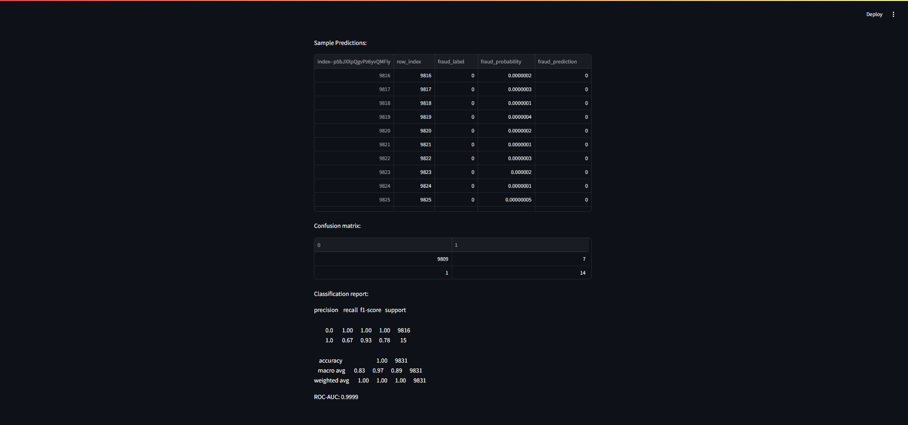
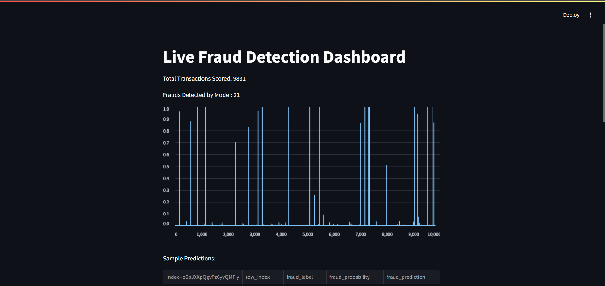

# End-to-End Credit Card Fraud Detection 

## Overview

A beginner-friendly, production-style machine learning pipeline for **credit card fraud detection** with XGBoost, FastAPI API deployment, real-time streaming simulation, and a live monitoring dashboard using Streamlit.  
It demonstrates data science, MLOps, and real-world deployment in one project.

---

## Project Structure

fraud-detection-mlops/
│
├── data/
│ └── X_test.csv
│
├── models/
│ └── fraud_xgb.joblib
│
├── notebooks/
│ └── <your-notebook(s)>.ipynb
│
├── app/
│ ├── api.py # FastAPI application
│ └── dashboard.py # Streamlit dashboard
│
├── simulate_stream.py # Simulate real-time scoring (sends X_test rows to the API)
├── requirements.txt
├── README.md
└── screenshots/
└── dashboard.png
└── api_docs.png

---

## How to Run ⚡

1. **Clone this repo and install requirements**
git clone https://github.com/vishnu-0567/fraud-detection-mlops.git
cd fraud-detection-mlops
pip install -r requirements.txt

2. **Train and save the model (notebooks/)**
- Use notebook(s) to train, save your final model as `models/fraud_xgb.joblib`.
- Make sure `data/X_test.csv` contains all features **plus** a `Class` column with the true label for later evaluation.

3. **Start the FastAPI server**
uvicorn app.api:app --reload

See docs at http://127.0.0.1:8000/docs

4. **Simulate transactions and log predictions**
python simulate_stream.py

- This sends each `X_test` row to the API and logs results in `stream_predictions.csv`

5. **Run the dashboard**
streamlit run app/dashboard.py

- Open suggested link to view live model predictions and metrics

---

## Example API Usage

**POST /predict**

Request:
{
"Unnamed: 0": 1,
"V1": -0.675,
"...": "...",
"TimeSinceLastTxn": 0.0
}

Response:
{
"fraud_probability": 0.001,
"fraud_prediction": 0
}

---

## Results

- **ROC-AUC:** _(add your value here)_
- **Precision / Recall:** _(add your value)_
- **Real-time monitoring:** via Streamlit dashboard
- **Explainability:** with SHAP in Notebooks

---

## Screenshots

---

## Notes

- **Large files** (`creditcard.csv`) are not included due to GitHub file size limits. Please download public datasets from [Kaggle](https://www.kaggle.com/mlg-ulb/creditcardfraud) and place as instructed in README.
- Use `X_test.csv` (small sample) for reproducibility or demo.

---

## License

-

---

**Built by Anthati Vishnu Vardhan**
